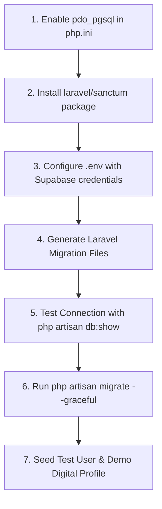

# LINKit — Database Setup & Implementation Plan
**Platform:** LINKit (Mobile-First Personal Digital Business Card Platform)  
**Database Engine:** Supabase PostgreSQL  
**Object Storage:** Supabase Storage  
**Backend Framework:** Laravel REST API (PHP 8.3)  
**Design Direction:** Monochrome (ink: `#111111`, paper: `#FFFFFF`, surface: `#F4F4F4`, line: `#E6E6E6`, muted: `#6B6B6B`)  

---

## 1. Overview & Architecture Strategy

LINKit requires a resilient, relational database optimized for:
1. **Ultra-fast read queries:** When an NFC card is tapped or a QR code is scanned, the public profile (`/c/{slug}`) must resolve in under 50ms.
2. **Strict data integrity:** Relationships between Users, Profiles, Links, and Analytics must support cascading deletes and transactional updates (e.g., link reordering).
3. **GDPR / Privacy Compliance:** Anonymized IP hashing for analytics collection without storing raw PII of profile visitors.
4. **Cloud-Native Compatibility:** Utilizing Supabase PostgreSQL with support for transaction connection pooling (Supavisor / PgBouncer on port `6543`) and direct connections (port `5432`).
5. **MVP vs Post-MVP Scope:**
   - **MVP:** Single active profile per customer, verified badge support (`is_verified`), theme key (`theme`, default "professional"), social/custom links, instant vCard download, dynamic QR generation, and privacy-first tap/scan analytics.
   - **Post-MVP:** Multi-profile switching (Personal vs. Business) and two-way Contact Exchange (lead capture form).

---

## 2. Step-by-Step Setup Plan

### Step 1: Local PHP Driver Configuration (Prerequisite)
During the technical audit, it was identified that `pdo_pgsql` is disabled in your local PHP installation (`C:\xampp\php\php.ini`). Before running database commands from your local machine, the driver must be enabled.

1. Open `C:\xampp\php\php.ini` in an editor.
2. Locate the following lines:
   ```ini
   ;extension=pdo_pgsql
   ;extension=pgsql
   ```
3. Remove the leading semicolons `;` to uncomment them:
   ```ini
   extension=pdo_pgsql
   extension=pgsql
   ```
4. Save the file and verify via terminal:
   ```powershell
   php -m | findstr pgsql
   ```
   *Expected output: `pdo_pgsql` and `pgsql`.*

---

### Step 2: Supabase Project Setup

1. **Create Supabase Project:**
   - Log in to [Supabase](https://supabase.com).
   - Create a new project (e.g., `linkit-production` or `linkit-dev`).
   - Select the region closest to your target audience.
   - Securely save the generated **Database Password**.

2. **Retrieve Connection Strings:**
   - In Supabase, navigate to **Project Settings** → **Database**.
   - Note the connection credentials:
     * **Host:** `aws-0-[region].pooler.supabase.com` (or direct host)
     * **Port:** `6543` (Connection Pooler - recommended for Laravel REST API) or `5432` (Direct connection for migrations)
     * **Database:** `postgres`
     * **User:** `postgres.[your-project-ref]`
     * **Password:** `[your-db-password]`

3. **Supabase Storage Buckets:**
   - Go to **Storage** → **New Bucket**.
   - Create the following public buckets:
     * `avatars`: Public bucket for user/profile photos (Max size: 2MB, Allowed MIME: `image/png`, `image/jpeg`, `image/webp`).
     * `banners`: Public bucket for profile cover photos (Max size: 5MB, Allowed MIME: `image/png`, `image/jpeg`, `image/webp`).
     * `qrcodes`: Public bucket for generated static QR code images/SVGs.

---

### Step 3: Laravel Environment Configuration

Update `backend/.env` with Supabase PostgreSQL connection parameters:

```env
# Database Connection Settings
DB_CONNECTION=pgsql
DB_HOST=aws-0-ap-southeast-1.pooler.supabase.com
DB_PORT=6543
DB_DATABASE=postgres
DB_USERNAME=postgres.[your-project-ref]
DB_PASSWORD=[your-supabase-db-password]
DB_SSLMODE=require

# Supabase Storage / S3-Compatible Driver
AWS_ACCESS_KEY_ID=[your-supabase-project-ref]
AWS_SECRET_ACCESS_KEY=[your-supabase-anon-or-service-key]
AWS_DEFAULT_REGION=us-east-1
AWS_BUCKET=avatars
AWS_ENDPOINT=https://[your-project-ref].supabase.co/storage/v1/s3
AWS_USE_PATH_STYLE_ENDPOINT=true
```

> **Important Note for Laravel with Supabase Connection Pooler (Port 6543):**  
> In `backend/config/database.php`, under the `pgsql` array, ensure `options` disables prepared statements when connecting through PgBouncer/Supavisor in transaction mode:
> ```php
> 'pgsql' => [
>     // ...
>     'sslmode' => env('DB_SSLMODE', 'require'),
>     'options' => [
>         PDO::ATTR_EMULATE_PREPARES => true,
>     ],
> ],
> ```

---

## 3. Database Schema Specification

Below is the database schema designed specifically for LINKit.

### Table 1: `users`
Managed by Laravel authentication. Stores account credentials and platform role.
* `id` (UUID, Primary Key, default `gen_random_uuid()`)
* `name` (VARCHAR 255, NOT NULL)
* `email` (VARCHAR 255, UNIQUE, NOT NULL)
* `email_verified_at` (TIMESTAMP, NULLABLE)
* `password` (VARCHAR 255, NOT NULL)
* `role` (VARCHAR 30, DEFAULT 'customer') — Values: `customer`, `super_admin`
* `remember_token` (VARCHAR 100, NULLABLE)
* `created_at`, `updated_at` (TIMESTAMPS)

### Table 2: `personal_access_tokens`
Managed by Laravel Sanctum. Holds API Bearer tokens for authenticated frontend sessions.
* `id` (BIGSERIAL / UUID, Primary Key)
* `tokenable_type` (VARCHAR 255, NOT NULL)
* `tokenable_id` (UUID, NOT NULL)
* `name` (VARCHAR 255, NOT NULL)
* `token` (VARCHAR 64, UNIQUE, NOT NULL)
* `abilities` (TEXT, NULLABLE)
* `last_used_at` (TIMESTAMP, NULLABLE)
* `expires_at` (TIMESTAMP, NULLABLE)
* `created_at`, `updated_at` (TIMESTAMPS)

### Table 3: `profiles`
The profile is the product. Stores personal and professional digital business card identities accessed via NFC, QR, and URL.
* `id` (UUID, Primary Key, default `gen_random_uuid()`)
* `user_id` (UUID, Foreign Key → `users.id` ON DELETE CASCADE)
* `slug` (VARCHAR 100, UNIQUE, NOT NULL) — *Indexed; used in NFC taps & QR URLs: `linkit.id/c/{slug}`*
* `title` (VARCHAR 100, NOT NULL, e.g., "Main Profile", "Consulting")
* `first_name` (VARCHAR 100, NOT NULL)
* `last_name` (VARCHAR 100, NOT NULL)
* `prefix` (VARCHAR 20, NULLABLE, e.g., "Dr.", "Eng.")
* `headline` (VARCHAR 255, NULLABLE, e.g., "Lead Architect @ TechCorp")
* `company` (VARCHAR 150, NULLABLE)
* `department` (VARCHAR 150, NULLABLE)
* `bio` (TEXT, NULLABLE)
* `avatar_url` (TEXT, NULLABLE)
* `banner_url` (TEXT, NULLABLE)
* `is_verified` (BOOLEAN, DEFAULT false) — *Verified checkmark badge displayed on the public sheet*
* `theme` (VARCHAR 50, DEFAULT 'professional') — *Theme key: default `"professional"` (built-ins: `professional`, `minimal`, `dark`, `creative`, `nature`, `playful`)*
* `is_active` (BOOLEAN, DEFAULT true)
* `is_public` (BOOLEAN, DEFAULT true)
* `created_at`, `updated_at` (TIMESTAMPS)

> **Scope Note:**
> - In **MVP**, each customer has one primary active profile.
> - Switching between "Personal" and "Business" profiles via the top-left icons is **[post-MVP]**.
> - The two-way "Exchange" contact pill on the public sheet is **[post-MVP]**.

### Table 4: `profile_links`
Stores all contact channels, social networks, and custom interactive buttons displayed on the profile.
* `id` (UUID, Primary Key, default `gen_random_uuid()`)
* `profile_id` (UUID, Foreign Key → `profiles.id` ON DELETE CASCADE)
* `platform` (VARCHAR 50, NOT NULL) — e.g., `phone`, `email`, `whatsapp`, `linkedin`, `github`, `website`, `custom`
* `label` (VARCHAR 100, NOT NULL) — Display title (e.g., "Connect on LinkedIn", "Schedule Call")
* `value` (TEXT, NOT NULL) — Destination URL, phone number with country code, or email
* `icon` (VARCHAR 50, NULLABLE) — Lucide icon identifier
* `display_order` (INTEGER, DEFAULT 0) — Ordering on the mobile sheet view
* `is_active` (BOOLEAN, DEFAULT true)
* `created_at`, `updated_at` (TIMESTAMPS)

### Table 5: `profile_analytics`
Privacy-preserving event logging for NFC taps, QR code scans, profile views, and link interactions.
* `id` (UUID, Primary Key, default `gen_random_uuid()`)
* `profile_id` (UUID, Foreign Key → `profiles.id` ON DELETE CASCADE)
* `profile_link_id` (UUID, NULLABLE, Foreign Key → `profile_links.id` ON DELETE SET NULL)
* `event_type` (VARCHAR 50, NOT NULL) — Values: `profile_view`, `nfc_tap`, `qr_scan`, `vcard_save`, `link_click`
* `ip_hash` (VARCHAR 64, NOT NULL) — SHA-256 hashed IP for anonymous unique visitor counting (never raw IP)
* `device_type` (VARCHAR 20, NULLABLE) — `mobile`, `tablet`, `desktop`
* `browser` (VARCHAR 50, NULLABLE)
* `os` (VARCHAR 50, NULLABLE)
* `referrer` (VARCHAR 255, NULLABLE)
* `created_at` (TIMESTAMP, default `NOW()`)

### Table 6: `nfc_badges`
Hardware provisioning table mapping physical NFC cards/tags to digital profiles.
* `id` (UUID, Primary Key, default `gen_random_uuid()`)
* `profile_id` (UUID, NULLABLE, Foreign Key → `profiles.id` ON DELETE SET NULL)
* `tag_uid` (VARCHAR 100, UNIQUE, NOT NULL) — Hardware NFC UID
* `activation_code` (VARCHAR 32, UNIQUE, NOT NULL) — Security code for initial card claim
* `status` (VARCHAR 30, DEFAULT 'unassigned') — Values: `unassigned`, `active`, `disabled`, `lost`
* `activated_at` (TIMESTAMP, NULLABLE)
* `created_at`, `updated_at` (TIMESTAMPS)

---

## 4. Execution Sequence (To Be Run Upon Approval)

When authorized to implement, execute in the following exact order:



1. **Install Sanctum & API Scaffold:**
   ```bash
   php artisan install:api
   ```
2. **Generate Migrations with UUID support:**
   * `php artisan make:migration create_profiles_table`
   * `php artisan make:migration create_profile_links_table`
   * `php artisan make:migration create_profile_analytics_table`
   * `php artisan make:migration create_nfc_badges_table`
3. **Verify Database Connectivity:**
   ```bash
   php artisan db:show
   ```
4. **Execute Migrations:**
   ```bash
   php artisan migrate
   ```
5. **Create Seeders & Factories:**
   * Create `ProfileFactory` and `ProfileLinkFactory` to seed a demo NFC digital profile for development and testing.

---

## 5. Security & Maintenance Rules
* **Always use UUIDs:** Prevent URL enumeration by never exposing auto-incrementing integer IDs.
* **Prepared Statements & Sanitization:** Use standard Eloquent ORM bindings to prevent SQL injection.
* **Index Critical Paths:** Ensure `profiles(slug)`, `profile_links(profile_id, display_order)`, and `profile_analytics(profile_id, created_at)` have composite indexes for rapid read and analytics aggregation.
* **IP Hashing:** Never store raw visitor IPs in `profile_analytics`. Always hash with a salt: `hash('sha256', $ip . config('app.key'))`.
* **Data Retention:** Schedule pruning for `profile_analytics` records older than 180 days to prevent uncontrolled table growth.
